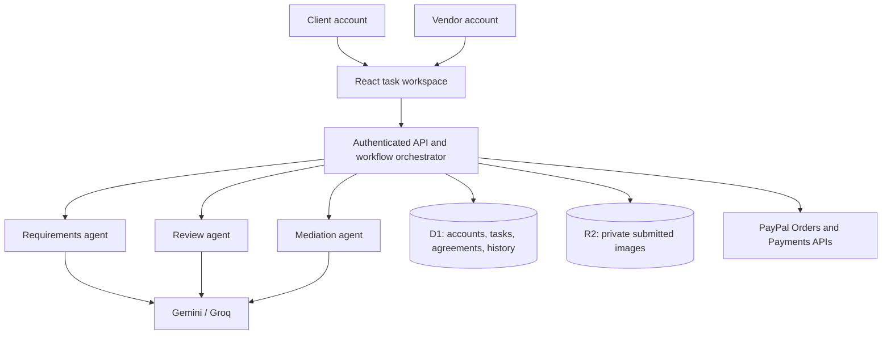

# Pact

### Good work. Fair pay.

**Pact is an AI-assisted workspace that helps clients and independent vendors agree on what “done” means, improve submitted work, and finish projects with clear evidence and shared expectations.**

A client describes a task. Pact turns the brief into a checklist, asks about important ambiguities, and lets the client confirm the agreement before inviting a vendor. The vendor submits work against that same agreement. Three AI specialists help clarify expectations, review deliverables, and answer questions from either side, while the application controls the workflow and the client makes the final acceptance decision.

## Why Pact exists

Freelance projects often begin with a trust gap:

- A client wants confidence that the promised work will be delivered before committing payment.
- A vendor wants confidence that the client is committed before spending time on the work.
- Both sides may interpret a short brief differently.
- Feedback can mix missing agreed work with entirely new requests.
- A disagreement becomes difficult to resolve when the original expectations were never written clearly.

Pact addresses these problems by making the agreement explicit, keeping the work and its revision history together, and connecting every review or objection to the confirmed requirements.

The goal is to make collaboration easier to understand: **clear requirements at the beginning, specific feedback during the work, and an explicit acceptance at the end.**

## Who it is for

Pact is designed for clients commissioning small creative or writing projects and vendors delivering those projects. The current interface supports content writing, copywriting, and social media work.

Typical uses include:

- Product descriptions and campaign copy.
- Instagram designs and accompanying captions.
- Brand messaging with a specified tone and audience.
- Small visual deliverables with measurable requirements, such as dimensions, colors, text, and object counts.
- Projects where both parties want a written record of the agreed scope and the reasons behind revisions.

For example, a clothing business could ask for three Instagram posts and three product descriptions for a casual dupatta collection. Pact can help clarify the deliverables, language, brand voice, and required product details before a vendor accepts the task. During review, the AI can point to a missing agreed item and ask the vendor to explain or revise it.

## The project journey

### 1. Describe the work

The client creates a task with a title, brief, category, budget, and delivery date. The brief should describe the deliverables, audience, format, and essential details.

### 2. Clarify and confirm the agreement

The Requirements agent extracts a checklist and asks follow-up questions when important details are unclear. The client can respond and edit the checklist before confirming it.

The confirmed checklist becomes the shared agreement. Its wording stays fixed throughout the task so reviews and conversations have a consistent reference point.

### 3. Find and invite a vendor

Vendors register with their own accounts and publish profiles containing their skills, introduction, biography, and availability. The directory prioritizes skill-tag matches for the task category. The client selects a vendor and sends an invitation.

The invited vendor reviews the same checklist, budget, and deadline before accepting. Clients and vendors use separate accounts, and the server checks which actions each participant can perform.

### 4. Authorize the agreed payment

After vendor acceptance, the client proceeds through the connected PayPal checkout. The workflow records an authorization before allowing work submissions. Capture is a separate step that follows final client acceptance.

See [Payment integration status](#payment-integration-status) for the environment and capabilities included in this release.

### 5. Submit text, images, or both

The vendor submits work in **The work** tab. Each submission creates a new saved version.

Image submissions support:

- PNG and JPG files.
- Up to three images per submission.
- Up to 2 MB per image.
- Dimensions up to 4096 × 4096 pixels.
- Up to 24 saved images across a task’s revision history.

The interface provides a file picker, local previews, removal before submission, and a version selector for reviewing earlier work. Images are stored privately and remain accessible to the task’s participants. The vendor attaches the relevant images again when submitting a revised version.

### 6. Review against the actual agreement

The Review agent examines the latest submitted text and images against every confirmed requirement. It records a result for each checklist item:

- **Met:** the submitted work contains supporting evidence.
- **Missing:** an agreed requirement needs attention.
- **Needs clarification:** a criterion is subjective, ambiguous, or difficult to establish from the available evidence.

Text word counts and image dimensions are measured by the server. Visual findings refer to the submitted images. The client can inspect the evidence and explicitly confirm criteria that require human judgment.

### 7. Ask questions and revise

Either participant can ask the Mediation agent about the agreement or submitted work. It can explain a missing item, ask a focused follow-up question, and distinguish an agreed deliverable from a new request.

For example, when an agreement asks for three yellow circles and a submitted design contains two, Pact can identify the relevant requirement, explain the mismatch, and review a corrected submission. A request for an additional language that was never agreed can instead be identified as additional scope.

Messages, review results, and submission versions stay together in the task workroom.

### 8. Accept or cancel

The client accepts the latest reviewed submission after the checklist is resolved. The server validates the task state and payment authorization before requesting capture.

A client can also cancel an unfinished task. An uncaptured payment authorization is voided before the cancellation is saved. The agreement and conversation remain available to both participants.

## The AI team and orchestrator

Pact uses three specialist roles:

- **Requirements agent:** extracts deliverables and asks about missing or ambiguous details before scope confirmation.
- **Review agent:** checks the latest work against the confirmed checklist and returns requirement-level evidence.
- **Mediation agent:** answers client and vendor questions using the agreement, conversation, and latest submitted work.

A server-side orchestrator decides which specialist to call based on the requested action and task state. It enforces ownership, participant roles, valid transitions, submission version checks, and payment prerequisites.

The specialists make real provider requests. Gemini is the primary provider when configured, with Groq as a fallback. Either provider can also be used on its own. The image review and mediation paths send the actual submitted image bytes to the connected provider.

AI responses are validated against structured schemas. Reviews must include exactly the confirmed requirement IDs. Submitted text, image content, and messages are treated as untrusted evidence. Provider errors are surfaced clearly; a saved submission can be reviewed again without creating another version.

The client retains the final acceptance decision. AI outputs do not directly trigger payment release.

## Architecture



### Technology

- **Interface:** React 19, TypeScript, a Next-style App Router through Vinext, and Vite.
- **Design:** responsive custom CSS, a pink-and-yellow palette, and Lucide icons.
- **Server:** Cloudflare Workers.
- **Structured storage:** Cloudflare D1, SQLite, and Drizzle ORM.
- **File storage:** Cloudflare R2 with authenticated image-serving routes.
- **Validation:** Zod for request and AI response schemas.
- **Authentication:** email/password accounts and server-managed sessions.
- **AI:** Gemini and Groq adapters with provider fallback.
- **Payments:** PayPal REST Orders v2 and Payments v2.

### Data and access

Accounts and vendor profiles are stored separately from task documents. Each task records its participants, agreement, workflow stage, messages, submissions, review references, and payment references.

Task access is limited to the client and invited vendor. Image requests repeat the participant check and verify that the requested image belongs to a saved submission on that task.

Passwords use salted scrypt hashes. Session tokens are random, stored as hashes, and sent in HttpOnly, SameSite cookies. Logout revokes the server session. Login attempt limits, same-origin write checks, operation leases, and optimistic concurrency protect the shared workflow.

## Payment integration status

**This release uses PayPal Sandbox for payment testing. It does not move real money.**

The implemented flow includes OAuth authentication, order creation, buyer approval, authorization, capture after client acceptance, and cancellation of unused authorizations. These paths have been exercised against PayPal’s test service.

Payment requests use stable idempotency keys. Capture responses are checked for completion, currency, and amount. When PayPal returns a minimal response, Pact retrieves the capture details before recording success.

Captures go to the configured test merchant. Individual vendor onboarding and payouts, live-money processing, escrow, refunds, and webhook-based background reconciliation are future work. When payment credentials are absent, tasks use a clearly labelled simulated payment flow. Payment mode is fixed when a task is created.

## Run locally

### Requirements

- Node.js 22.13 or later.
- npm.
- Sufficient disk space for dependencies, build files, and uploaded work.
- At least one Gemini or Groq API key to create and review tasks.
- PayPal Sandbox application credentials to exercise the connected payment flow.

### 1. Clone and install

```bash
git clone https://github.com/maadilfaisal/pact-ai.git
cd pact-ai
npm run install:ci
```

### 2. Configure private values

Copy the template only if you have not already created your local configuration:

```bash
cp -n .dev.vars.example .dev.vars
```

Edit `.dev.vars` locally:

- `GEMINI_API_KEY`: Gemini credential; required when using Gemini.
- `GEMINI_MODEL`: defaults to `gemini-3.1-flash-lite`.
- `GROQ_API_KEY`: Groq credential; required when using Groq.
- `GROQ_MODEL`: defaults to `qwen/qwen3.8-27b`.
- `PAYPAL_CLIENT_ID`: client ID for a Sandbox REST application.
- `PAYPAL_CLIENT_SECRET`: secret for the same application.

Configure one AI provider or both. For image work, use a model that supports image input. Restart the server after changing configuration. The account screen indicates which services have credentials configured; provider availability and quotas still apply.

The repository contains an empty configuration template. Actual credentials belong in ignored local files or a deployment platform’s secret store.

### 3. Build and initialize a fresh database

```bash
npm run build
```

For a **new** local database, apply the migrations in order:

```bash
node --import ./scripts/sites-env.mjs ./node_modules/wrangler/bin/wrangler.js d1 execute DB --local --config dist/server/wrangler.json --persist-to .wrangler/state --file drizzle/0000_sturdy_caretaker.sql
node --import ./scripts/sites-env.mjs ./node_modules/wrangler/bin/wrangler.js d1 execute DB --local --config dist/server/wrangler.json --persist-to .wrangler/state --file drizzle/0001_flat_betty_ross.sql
```

Keep an existing database intact and apply only migrations that have not already been applied. Schema changes use `npm run db:generate` to create a new migration.

### 4. Start Pact

```bash
npm run dev -- --port 5173
```

Open [http://127.0.0.1:5173/](http://127.0.0.1:5173/).

On Linux or macOS, the executable launcher provides the same start command:

```bash
./start-local.sh
```

Dependencies and local D1/R2 state live on disk. Starting the application again preserves the existing accounts and work. The launcher is a manual command rather than an operating-system startup service.

### 5. Try both sides of a project

1. Create a client account with **Hire someone**.
2. Create a vendor account with **Offer my skills** and complete its profile.
3. Use separate browser profiles or browsers to stay signed in as both participants. Ordinary tabs in the same browser share a session.
4. As the client, create a task, clarify its brief, confirm the checklist, and invite the vendor.
5. As the vendor, accept the agreement.
6. As the client, approve the test checkout with a Sandbox Personal buyer account. This login is separate from the Pact account.
7. As the vendor, submit text or images, review the feedback, ask questions, and submit revisions.
8. As the client, inspect the latest work, resolve uncertain criteria, and accept or request an agreed revision.

No pre-created account passwords or payment logins are included in this repository.

## Validation

```bash
npm run typecheck
npm run test:agents
npm run test:paypal
npm run test:files
npm run test:smoke -- http://127.0.0.1:5173
```

The focused suites cover AI response validation and image transport, payment responses and reconciliation, file validation and storage reads, and local account boundaries. Provider adapter tests use mocked responses and do not call external services.

The local smoke test creates disposable accounts and removes only its own records. Run it against a local loopback server after building, with the existing local migrations applied. Avoid running a build concurrently with this test’s database cleanup.

An additional live AI workflow is available in an environment without PayPal credentials:

```bash
npm run test:smoke -- http://127.0.0.1:5173 --live
```

That workflow uses real AI requests with simulated payment transitions. Connected PayPal checkout requires browser approval by a test buyer. See [VALIDATION.md](VALIDATION.md) for the verified workflows and their limits.

## Source guide

- `app/pact-app.tsx`: account entry, dashboards, vendor directory, workroom, submissions, image previews, and client acceptance.
- `app/globals.css`: responsive interface styling.
- `app/api/auth/route.ts`: registration, login, logout, and current account.
- `app/api/workspace/route.ts`: participant-scoped workspace loading.
- `app/api/vendors/route.ts`: account-linked vendor profile updates.
- `app/api/tasks/route.ts`: task creation and initial brief clarification.
- `app/api/tasks/[id]/action/route.ts`: role-checked workflow orchestrator.
- `app/api/tasks/[id]/images/[imageId]/route.ts`: private submitted-image access.
- `app/api/paypal/return/route.ts`: checkout return validation and authorization.
- `lib/pact/agents.ts`: Requirements, Review, and Mediation specialists.
- `lib/pact/auth.ts`: password hashing, sessions, and attempt limits.
- `lib/pact/files.ts`: bounded multipart parsing, image checks, storage, and AI image loading.
- `lib/pact/paypal.ts`: payment transport and capture verification.
- `lib/pact/server.ts`: configuration, access checks, state persistence, and concurrency guards.
- `lib/pact/types.ts`: domain types and workflow stages.
- `db/` and `drizzle/`: schema and migrations.
- `scripts/test-*.mjs` and `scripts/smoke.mjs`: verification suites.
- `.dev.vars.example`: configuration names with empty credentials.
- `.openai/hosting.json`, `vite.config.ts`, and `worker/`: build integration and storage binding declarations.

## Current boundaries and next steps

The current version supports text and PNG/JPG work, one selected vendor per task, and one final acceptance/payment step. Vendor discovery uses skill tags followed by client selection. Workspace updates refresh periodically and when the window regains focus.

Future work includes additional document formats, richer vendor recommendations, formal appeals and human escalation, email verification and password recovery, outgoing notifications, milestone workflows, and the remaining payment capabilities described above.

AI findings can be questioned and may require human judgment. Pact grounds the conversation in the recorded agreement and observable submission evidence, helping both sides reach a clearer, more accountable finish.
